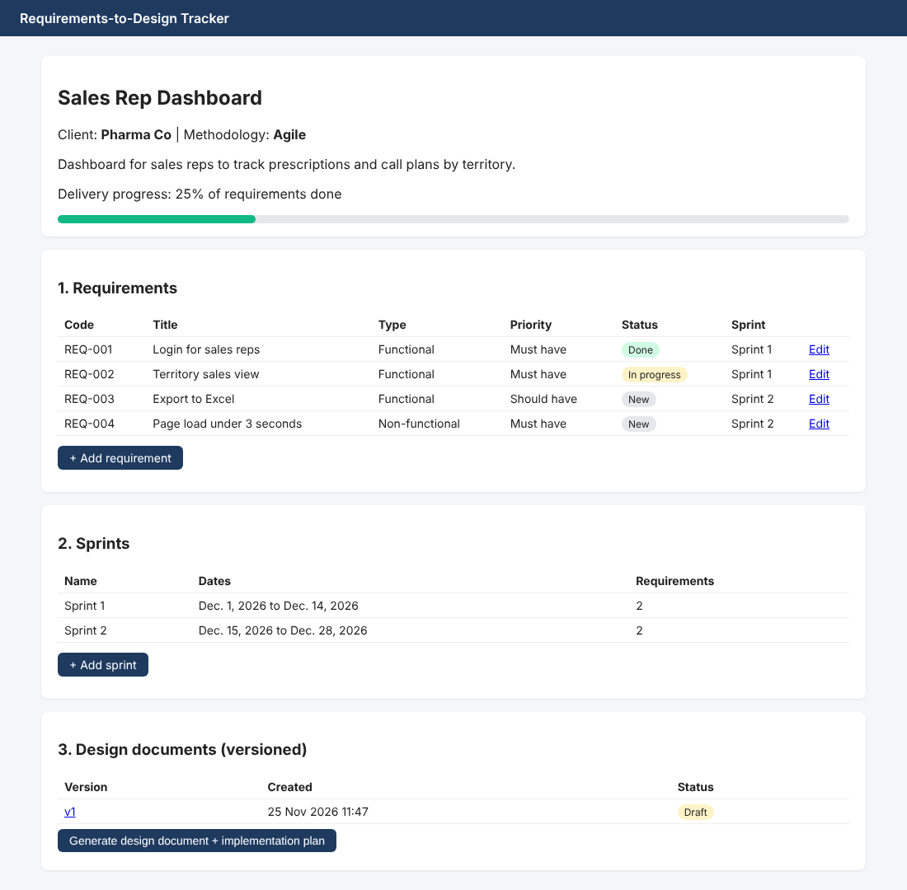

# Client Requirements-to-Technical-Design Tracker

A small full-stack Django app that simulates how a consulting / IT delivery team runs a client engagement:

1. **Capture** business requirements from client stakeholders.
2. **Plan** them into Agile sprints or Waterfall milestones.
3. **Auto-generate** a technical design document and implementation plan from those requirements.
4. **Review**: the client approves or requests changes on each **versioned** document.
5. **Track** delivery progress as requirements move from New to Done.

**Stack:** Python, Django, PostgreSQL (SQLite for quick local runs), pytest, GitHub Actions CI/CD, Azure App Service.



---

## How the app works (the business flow)

```
Client project (Agile or Waterfall)
   │
   ├─ Requirements (REQ-001, REQ-002 ...)  ── planned into ──►  Sprints / Milestones
   │
   └─ "Generate design document"  ──►  Design Doc v1 (Draft)
                                          │
                       Client review: "Changes requested"
                                          │
          update requirements, regenerate ──►  Design Doc v2 (Draft)
                                          │
                       Client review: "Approved"  ✔ sign-off
```

- An **Agile** project plans work in **Sprints**; a **Waterfall** project plans work in **Milestones**. The app picks the right one automatically from the project's methodology.
- Every time you generate a document, a **new version** is created. Old versions are kept for audit history.
- Only the **latest** version can be signed off, so a client can never approve an out-of-date design.

---

## Database design (normalised relational schema)

| Table | Key columns | Relationship |
|-------|-------------|--------------|
| `Project` | name, client_name, methodology (AGILE / WATERFALL) | has many Requirements, Iterations, Documents |
| `Iteration` | kind (SPRINT / MILESTONE), name, start_date, end_date | belongs to a Project |
| `Requirement` | code, title, type, priority (MoSCoW), status, stakeholder | belongs to a Project, optionally planned into one Iteration |
| `DesignDocument` | version, content, status (Draft / Approved / Changes requested) | belongs to a Project |
| `SignOff` | reviewer_name, decision, comments, signed_at | belongs to a DesignDocument |

Data rules enforced in the database:
- Requirement `code` is unique **within a project** (`REQ-001` can exist in two different projects, not twice in one).
- Document `version` is unique **within a project**.

Why normalised: each fact is stored once. For example, the client name lives only on `Project`, and a requirement points to its sprint by foreign key instead of copying the sprint name. This avoids update anomalies.

```
Project 1───* Requirement *───0..1 Iteration
Project 1───* Iteration
Project 1───* DesignDocument 1───* SignOff
```

---

## How the design document is "auto-generated"

No AI is used. It is **rule-based template generation** (`tracker/services.py` + `tracker/templates/tracker/design_doc.md`):

| Document section | Built from |
|------------------|-----------|
| Functional / Non-functional requirements | Requirements split by `requirement_type` |
| Proposed technical design | One **module per functional requirement** |
| Implementation plan | Each sprint/milestone with its requirements, and standard steps per requirement: Design → Build → Unit test → SIT → Client review |
| Testing approach | Standard QA section (unit tests + SIT + client review) |

This keeps it predictable and testable: same requirements in, same document out.

---

## Code structure

```
config/settings.py        Settings. Uses PostgreSQL if POSTGRES_DB is set, else SQLite
tracker/models.py         The 5 tables above
tracker/services.py       Business logic: generate_design_document(), record_signoff()
tracker/forms.py          Input validation (dates, duplicate codes)
tracker/views.py          Thin views: read form -> call service -> render page
tracker/templates/        HTML pages + the design document template
tracker/management/commands/seed_demo.py   Demo data
tests/                    pytest unit tests + SIT end-to-end test
docs/SIT_test_cases.md    SIT test case sheet
.github/workflows/ci-cd.yml   CI/CD pipeline
startup.sh                Azure App Service startup command
```

Business logic is kept in `services.py` (not inside views) so it can be unit tested on its own.

---

## Run it locally (about 2 minutes)

```bash
python -m venv venv
venv\Scripts\activate          # Windows   (Mac/Linux: source venv/bin/activate)
pip install -r requirements.txt
python manage.py migrate
python manage.py seed_demo     # loads 2 demo client projects
python manage.py runserver
```

Open http://127.0.0.1:8000. Optional admin panel: `python manage.py createsuperuser`, then go to `/admin`.

**Using PostgreSQL locally** (optional): set these environment variables before running:
`POSTGRES_DB`, `POSTGRES_USER`, `POSTGRES_PASSWORD`, `POSTGRES_HOST`, `POSTGRES_PORT`.

### Demo script (what to click)
1. Open **Sales Rep Dashboard** (Agile, Pharma client): see 4 requirements across 2 sprints, 25% done.
2. Click **Generate design document**: v1 is created in Draft.
3. As the client, choose **Changes requested** with a comment.
4. Edit a requirement (e.g. mark REQ-002 Done), go back, generate again: **v2** appears and v1 is kept.
5. Approve v2. Try opening v1: it can no longer be signed off.
6. Open **Data Warehouse Migration** (Waterfall): the same screen shows **Milestones** instead of sprints.

---

## Testing (QA)

```bash
pytest -v
```

12 tests, in two layers:

| Layer | File | What it checks |
|-------|------|----------------|
| Unit tests | `tests/test_models.py`, `tests/test_services.py` | Progress %, unique codes, versioning, document content, sign-off rules |
| SIT (System Integration Testing) | `tests/test_sit_flow.py` | Full flow through real URLs, forms, services and DB: create project → add sprint → add requirement → generate doc → change request → v2 → approve. Plus invalid input cases |

The manual SIT test case sheet (IDs, steps, expected result) is in [docs/SIT_test_cases.md](docs/SIT_test_cases.md).

---

## CI/CD (GitHub Actions → Azure App Service)

File: `.github/workflows/ci-cd.yml`

On every push and pull request:
1. **Test job**: starts a real PostgreSQL 16 container, installs dependencies, runs `manage.py check`, checks no migrations are missing, runs `pytest`.
2. **Deploy job**: only on push to `main` and only if tests passed. Deploys the code to Azure App Service. It skips itself if Azure is not configured yet, so the pipeline stays green.

### Deploying to Azure App Service (one-time setup)
1. In the Azure Portal create:
   - an **Azure Database for PostgreSQL – Flexible Server** (create a database named `tracker`),
   - a **Web App** with runtime **Python 3.12** on Linux.
2. In the Web App → **Configuration → Application settings**, add:
   `POSTGRES_DB`, `POSTGRES_USER`, `POSTGRES_PASSWORD`, `POSTGRES_HOST` (your server, e.g. `myserver.postgres.database.azure.com`), `POSTGRES_SSLMODE=require`, `DJANGO_SECRET_KEY` (any long random string), `DJANGO_DEBUG=False`.
3. Web App → **Configuration → General settings → Startup command**: `bash startup.sh`
   (runs migrations, collects static files, starts gunicorn).
4. Web App → **Overview → Download publish profile**. In GitHub repo → **Settings → Secrets and variables → Actions**:
   - add secret `AZURE_WEBAPP_PUBLISH_PROFILE` = contents of that file,
   - add variable `AZURE_WEBAPP_NAME` = your web app name.
5. Push to `main`. GitHub Actions tests, then deploys.

Azure automatically sets `WEBSITE_HOSTNAME`; `settings.py` reads it to allow the Azure domain.

---
---

## Design decisions

- **Business logic in `services.py`, not in views.** Views only handle HTTP; the rules (versioning, sign-off) live in plain functions that are easy to unit test and reuse.
- **Rule-based document generation.** Deterministic output from the same requirements makes the documents predictable and testable.
- **Immutable document versions.** Regenerating never overwrites; every version and every review decision is kept as an audit trail.
- **One model for both methodologies.** An `Iteration` is either a Sprint or a Milestone, so Agile and Waterfall projects share the same schema and screens.

## Future improvements

- Login and roles (client reviewer vs delivery team)
- Email notifications when a document is ready for review
- Side-by-side diff between document versions
- Export design documents to PDF / Word
